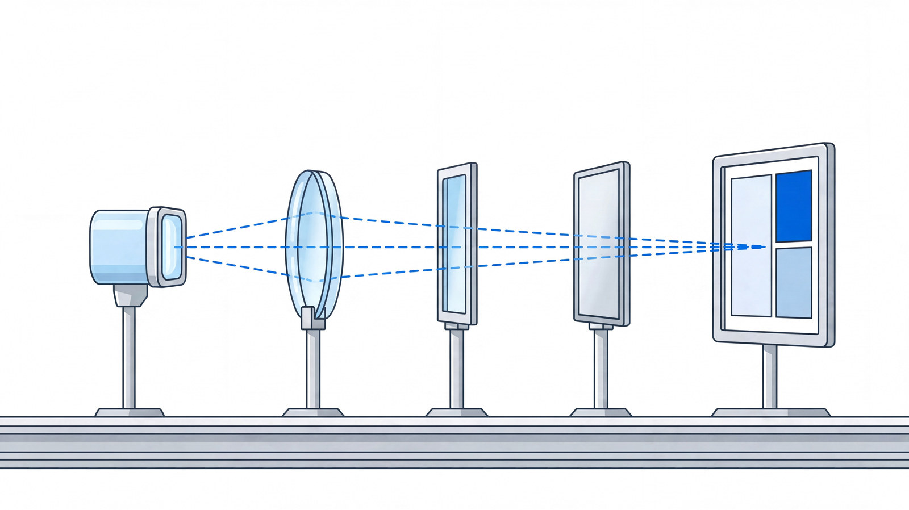
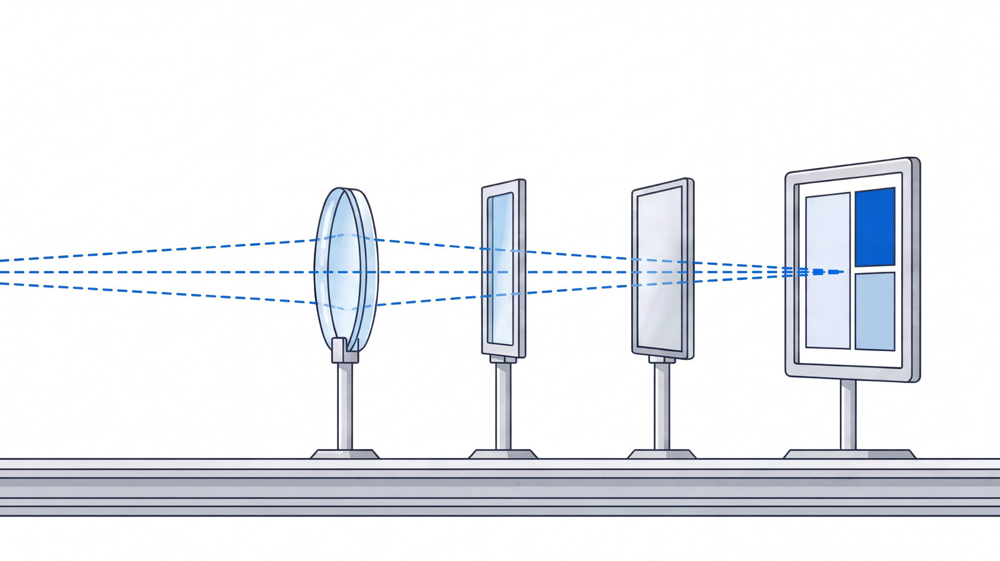

# 认识模型



大模型底层做的事其实很简单：看一眼前面的文字，猜下一个最可能出现的词，然后一个词一个词接下去。不过想让它稳定地帮你把活干好，光靠模型自己还不够。就像搭一间摄影棚一样，得靠光源（模型）、架子（Harness）、凸透镜（任务简报与上下文）、滤镜（技能）和柔光镜（护栏）这五层配合起来。

## 光源：模型

把模型类比成光源，每次输出就是从海量可能里收束出来的一道光。按任务复杂度和风险选模型，对应四种常见光源：

- **煤油灯（小模型、本地模型）**：亮得有限，适合起草思路和低风险杂活，做不了精细推理。
- **白炽灯（主流通用模型）**：稳定够用，日常文档和常规整理都能接。
- **太阳（前沿大模型）**：光线极亮且推理深，复杂分析、对客方案和开放问题需要这一档。
- **LED 面板（专用或微调模型）**：省电稳定，适合固定格式报表，换到新场景往往不够。


写周报用白炽灯就够，写对客方案和复杂判断再上太阳级别的大模型。跑固定格式报表用专用模型更省，只打草稿时轻量模型也能顶一阵。

## 架子：Harness

Harness 就像摄影棚里的支架和供电系统。它把模型、透镜、滤镜和柔光镜装到一起，接通你电脑里的文件和工具命令，也把操作权限和运行步骤看住。

随便打开一个网页会话直接说「写一份日报」，模型只能吐出一份通用空壳：

```markdown
# 工作日报
日期：XXXX年XX月XX日
汇报人：[您的姓名]
### 今日工作总结
完成了[具体工作内容1]，目前进度为[XX%]；
跟进了[具体项目/事项2]，协调解决了[相关问题]；
### 存在问题与需要协助
[描述遇到的问题及需要的支持 / 暂无]
```

这份模板看着像模像样，其实全是一堆填空题，里面半点真实情况都没有。问题不在模型偷懒，而在网页对话框够不着你的工作现场。换到能接入本地文档、会议纪要和办公软件的 Harness，模型先读过你手头的真实记录，再顺着写出来，拿过去几乎就能直接用。

能这样带着架子调工具、按步骤推进任务的 AI，平时也常叫**智能体（Agent）**。

> 常见的 Harness 有：WorkBuddy、Qoder、豆包工作、DeepSeek Harness、Codex 等。

## 聚光与护栏：从透镜到柔光镜

模型选对、架子接通后，输出能否对齐现场，靠三层调光件把关：



### 凸透镜：任务简报与上下文

透镜把散光收成一点。任务简报写清给谁看、做什么决定、怎么验收；上下文决定当前会话放进哪些权威材料。具体写法见 [交代任务](/ai/02-brief)。

### 滤镜：技能（Skills）

滤镜把某类工作的标准步骤、指标口径和范例打包保存，用时拧上、不用卸下。没有专业滤镜容易泛泛而谈，装错滤镜则会跑偏。沉淀方法见 [知识沉淀](/ai/05-assets)。

### 柔光镜：输出规范与护栏

柔光镜的作用是把过强的光柔化下来。平时我们在全局指令和项目指令里写下的格式要求、禁用词和合规红线，干的就是这个活：划清楚哪些必须做到、哪些绝对不能碰，把需要拍板的业务判断留给人。权限红线见 [安全与边界](/ai/04-safety)，长期规则写法见 [知识沉淀](/ai/05-assets)。

## 按任务配齐装备

日常干活不用每次把五层配置拉满，按任务的风险和复杂度来搭就行：

- 写内部周报：主流通用模型配常用 Harness 读本周记录，写清范围和字数，挂上周报技能就够了。
- 出对客方案：上前沿大模型保证思考深度，用能直连历史合同与纪要的 Harness，装上方案技能，顺带提醒它别瞎编承诺。
- 跑固定格式报表：专用模型往往更稳更省，接好数据源与脚本，再配上校验严格的报表技能。

## 输出不对时先查哪一层

结果不理想时，反复追问「写专业一点」通常救不回来。按下面这张表从底层往上排查，比盯着输入框死磕更快：

| 翻车现场 | 缺的那件 | 先补什么 |
|---|---|---|
| 复杂逻辑推不动，长文写到一半散掉或胡编 | 模型（光源太暗） | 换更强的模型，或把大任务拆小 |
| 读不到本地材料，改不了文件，聊完还得自己重贴 | Harness（架子没接通） | 换能读工作目录与工具的 Harness |
| 输出泛泛而谈，或聊久了忘了前面的规矩 | 任务简报与上下文（透镜没擦净） | 补齐目标、材料与验收，或清桌重开 |
| 格式结构没错，但不符合团队口径与专业路数 | 技能（没装滤镜） | 加载对应技能，或把真实样例写进技能 |
| 语气生硬、乱下承诺，或夹带了内部敏感数据 | 护栏（缺少柔光镜） | 先脱敏再发，并在边界里写死禁止项 |

## 自查

<Checklist id="ch01-light-check" :items="[
  '光源够不够？复杂任务是模型能力不足，还是任务本身该拆小？',
  '架子通不通？Harness 能读到真实材料、跑通工具并看到结果吗？',
  '透镜对准了吗？目标、范围、材料和验收写清了吗？',
  '滤镜装对了吗？有没有加载对应的技能来对齐团队口径？',
  '柔光镜加上了吗？格式规范、语气分寸和禁止红线写清了吗？',
  '输出翻车时，是先从底层往上排查，还是只在输入框里反复催促？'
]" />

## 延伸阅读

- [What Is ChatGPT Doing … and Why Does It Work?](https://writings.stephenwolfram.com/2023/02/what-is-chatgpt-doing-and-why-does-it-work/)，英文。读第一节「It’s Just Adding One Word at a Time」。这一节不用公式，讲清「预测下一个词」。中文版是《这就是 ChatGPT》。
- [《人工智能小白书》](https://lixiaolai.com/books/little-book-of-ai) 的第 3、6、7 章，中文。三章的章名是「智能的核心：判断」「人工智能的特长」「人工智能排斥懒人」，和这一页的能力边界对得上。
- [LLM Powered Autonomous Agents](https://lilianweng.github.io/posts/2023-06-23-agent/)，英文。读「Agent System Overview」一节。它把智能体拆成规划、记忆、工具三块，对应架子里的循环与工具调用。

<p class="bk-reading-note">注：具体章节及页码，取决于发行版本。</p>
