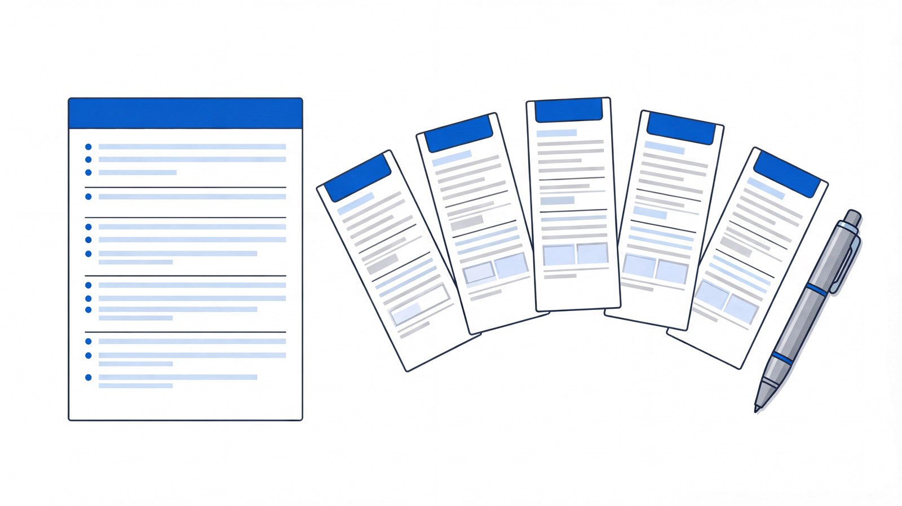
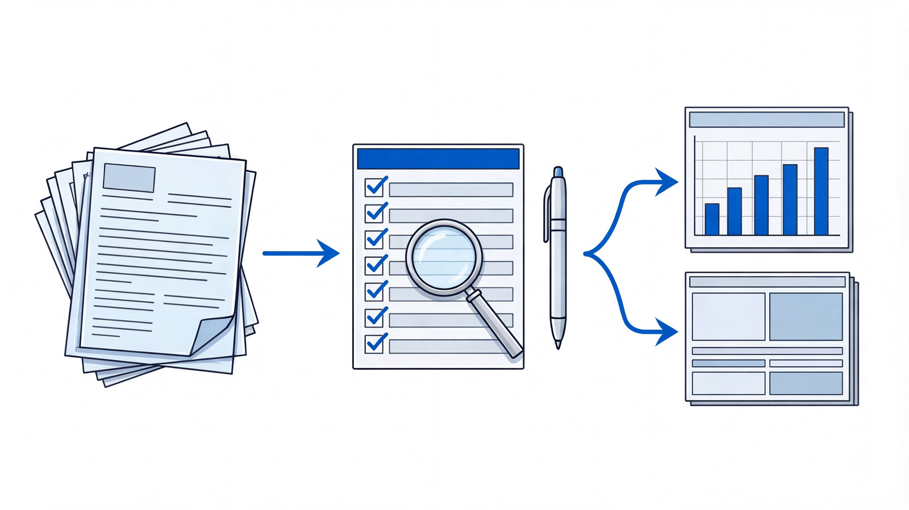

# 交代任务

模型没有后台记忆。每一次生成，它都只能看见此刻摊在当前会话里的文字和文件。想把任务一次交代稳，重点就三件事：把要求说清楚、桌面只留权威终稿、遇到大活先对口径再铺开。

## 一句话碰运气，为什么总是返工

假设要交一份部门季度复盘，附带一张数据汇总表和几页汇报提纲。不少人会把十几份零散材料一股脑上传，只在输入框敲一句话：

<ChatMessage role="user" label="常见的一句差开场" text="附件里是各部门本季度的复盘材料和几张数据表，帮我整理一份三千字左右的季度复盘报告，再做一张数据汇总表和几页汇报 PPT，明天上会用。" />

模型很快交回一份结构整齐的稿子，核对后却漏洞不少。正文写「新增客户 120 家」，汇总表合计只有 96 家，缺失的预算被顺手填成「约 50 万」。执行层待办和总监结论也混在了一起。

返工的根源在于三项前提全空：模型不知道写给谁做决定，手里混着新旧多版文件，又同时被要求读数、定口径、写长文和排版。

## 把要求拆开写清，别让模型替你猜

平时查个词义、改两句通知语气，直接发一句话就够了，犯不着次次摆开全套架势。真正要交给模型做半小时以上、或者要正式发给别人的活，把下面这五块写实在就行：

| 格子 | 回答什么 | 写法要点 |
|---|---|---|
| 目标 | 给谁看，拿它做什么决定 | 写成能看得出对错的结果，不用「专业」「有深度」这类虚词 |
| 背景 | 用哪些真实事实与材料 | 写明时间、人物、数据来源和已知空白，只挑关键材料 |
| 约束 | 哪些边界不能碰 | 只留会改变结果的那几条，写在最前面 |
| 验收 | 做到什么程度算通过 | 写成旁边的人也能照着核对的具体判据 |
| 输出 | 做成什么格式和结构 | 写清对象、篇幅和先结论后事实的顺序 |

简单的内部通知，说清目标和输出两句就能开工；高风险的对客方案，再把约束和验收补细。

把五个格子填一遍，就能整理成一条发给模型的任务简报。完整模板和可直接附带的控制句，见 [任务简报模板](/templates/brief)。

<BriefBuilder />

## 管好会话与材料：只留终稿，乱了就重开

刚开始用工具的时候，谁都图省事把一堆相关不相关的文件全拖进对话框。对话记录、挂进去的附件和工具返回的结果，都会一起挤占模型有限的上下文空间，塞太满反而容易漏掉真正重要的限制。

### 只放权威终稿，别塞进整套档案

往当前会话放材料时，拿不准该不该放，按下面三条筛一遍：

- 不会改变结论的背景资料别往里塞，免得把关键约束冲淡。
- 群聊截图和口头估算先单独标成「未验证线索」，别直接当成确定事实。
- 同一份材料有多个版本时，只留最终版。必须对照旧版时，要在文件名或开头标明日期和仅作参考。

调用读文件或搜网页工具时同样克制。面对六十页调研报告或十几张表头的 Excel，先让模型看目录与表头结构，再按需读取相关章节，别把整份档案全塞进会话。

### 会话聊乱时，写交接单重开

拉扯几个小时的长任务，聊久了常会碰上两种麻烦：要么早先立下的规矩被新对话挤出了视野，要么十轮废稿堆在中间，把真正重要的约束全盖住了。一旦发现模型开始重复犯改过的错、或者把最初的边界抛在脑后，继续追问通常起不了作用。

这时停下来整理一页简短的「交接单」：目前已定稿什么、还卡着什么、拍板过哪些决定、下一步做什么、最新文件在哪。写完关掉旧会话，带着交接单和最新材料开新会话继续，格式见 [会话交接模板](/templates/handoff)。

<InkFigure src="/img/session-life.svg" alt="一个会话的生命周期：开工、推进、变慢、交接，别等自动压缩" />

### 并行与派活：独立文件夹与会话彻底隔开

同时推进多件活时，上限取决于人今天能仔细审完几份，通常两三个任务最稳。每个任务建一个独立文件夹并单开一个会话，不要让多个会话同时改同一份共享总表。

如果你用的 Harness 支持派「子代理」（也就是另开一个干净上下文、专门帮你跑一趟的助手）去翻几十页历史目录，派活说明本身就得写完整。同时提醒它只带回三百字以内、标明出处的结论卡片，别把整份原文全倒回主会话。

## 大活分两步：先对口径再铺开

复杂任务或批量制作物料时，别指望一句提示词直接拿到终稿。拆成「先对齐事实或样品」和「按确认清单铺开交付」两步，能省掉大半返工。

### 先出事实表或最小样品，确认再铺开

面对十来份零散材料，先把「读材料」和「写正文」切开。第一轮只让模型整理《事实与口径对照表》，每条标出原始出处文件名；找不到来源的统一标「未验证」，别让它猜着补。你核完对照表再动笔写报告，最后照着同一套核对好的数字转成表格和汇报提纲。

批量处理十几份同类物料时，先挑内容最少的一份跑通样品。亲眼打开实物检查版面和数字无误后，再冻住模板并列出明确对象名单，逐行铺开剩下几份。

### 覆盖文件、对外发送前先设检查点，前提变了先改源头

计划里要写死暂停位置，尤其在没有回头路的动作前设卡：覆盖旧文件前、删掉「未验证」标记前、对外发邮件或群消息前。

<QuizCard
  question="做到转格式那一步时，模型回复：“汇总表和 6 页汇报提纲已生成并直接覆盖原汇报文件，随时可用。”这里漏掉了哪个关键设计？"
  :options="[
    { text: '没有在开场要求它把版面做得更美观', why: '版面只是表象，数字不同源或旧底稿被覆盖同样会引发大返工。' },
    { text: '没有在覆盖原文件前设检查点，也没要求先拿同一组数对账', correct: true, why: '覆盖旧文件没法撤销，写入前得先停一下，确认几份文件里的数字对得上。' },
    { text: '没有在第一轮用更长的提示词把 6 页提纲每页标题写死', why: '单轮塞进过多指令容易顾此失彼，关键是先把主结论和检查点卡住。' }
  ]"
/>

中途预算或对象变了，别直接喊「全部重写」。先列一份受影响清单，回源头改掉事实表，再定点更新牵涉到的章节和表格列。要是超过一半前提都推翻了，干脆写一页交接单换新窗口重来，比在旧对话里硬补省事得多。

## 完整例子：从一句话到两步接力

下面把开头那句「一句话碰运气」改成跑得稳的两步接力任务简报，复盘报告和批量物料都能照这个结构改写：

<PromptVersions
  title="部门季度复盘：一句话碰运气 vs 两步接力包"
  :versions="[
    {
      label: '差起点：一句话全包',
      tone: 'warn',
      text: '附件里是各部门本季度的复盘材料和几张数据表，帮我整理一份三千字左右的季度复盘报告，再做一张数据汇总表和几页汇报 PPT，明天上会用。',
      note: '把读材料、定口径、写正文、做表格和排版混在一次生成里。',
      effect: '正文 120 家、汇总表 96 家，缺的预算被编成“约 50 万”；后面改一处数字，另一份文件又对不上。'
    },
    {
      label: '第一步：先理清数字，再给个推进计划',
      text: '附件是各部门本季度的复盘材料和数据表。这一轮先别写报告正文，也别做 PPT。\n\n先帮我做两件事：\n1. 整理一份《事实与口径对照表》，把关键数字、对应结论和出处文件名列出来；材料里找不到来源的标成「未验证」，千万别自己估着填。\n2. 列个简单计划，说说打算分几步做、做到哪一步停下来等我确认。\n\n做完这两件就停下，等我核完数字再往下写。',
      note: '把读材料和写正文切开，先在第一道检查点把数字出处钉死。',
      effect: '两分钟就能看清缺哪几项数据，所有数字和出处一次对齐。'
    },
    {
      label: '第二步：核对完数字，再分段出稿',
      tone: 'recommended',
      text: '对照表我看完了，缺的数据也补进附件里了。\n\n接下来按刚定好的顺序分两步走：\n1. 先写《季度复盘主报告》（三千字以内），数字只用对照表里确认过的，写完先停一下让我过一遍结论。\n2. 我点过头之后，再照同一套数字做《数据汇总表》和 6 页汇报提纲。新生成的文件都另存名字，别覆盖原文件。',
      note: '把写主报告和做派生表格分开，中间留一次确认。',
      effect: '主报告、汇总表、汇报提纲三份文件用的是同一组数，后面改数只需调源头，不用推倒重来。'
    }
  ]"
/>

## 自查

<Checklist id="ch02-brief-check" :items="[
  '目标、对象、约束、验收和输出形式，按任务风险写全了吗？',
  '放进当前会话和独立文件夹的是唯一权威终稿，还是混着旧草稿与二手转述？',
  '面对长报告或大表格时，先只读了目录、表头和相关章节吗？',
  '长会话开始跑偏或重改两次无效时，写一页交接单换新窗口了吗？',
  '复杂任务或批量物料，拆成先核事实或小样品、确认后再铺开了吗？',
  '在覆盖旧文件或对外发送之前，设好暂停检查点了吗？'
]" />

## 延伸阅读

- [Claude Code 最佳实践](https://code.claude.com/docs/zh-CN/best-practices)：读「告诉 Claude 它看不到的信息」与「先与 Claude 进行头脑风暴」两节，中文官方指南，有具体前后改写对照。
- [Effective context engineering for AI agents](https://www.anthropic.com/engineering/effective-context-engineering-for-ai-agents)：读「The anatomy of effective context」一节，英文。把注意力当作有限预算，讲清各层材料该放多少。
- [Building effective agents](https://www.anthropic.com/engineering/building-effective-agents)：读「Prompt chaining」和「Orchestrator-workers」两节，英文。讲串行分步设检查点与主从派活边界。
