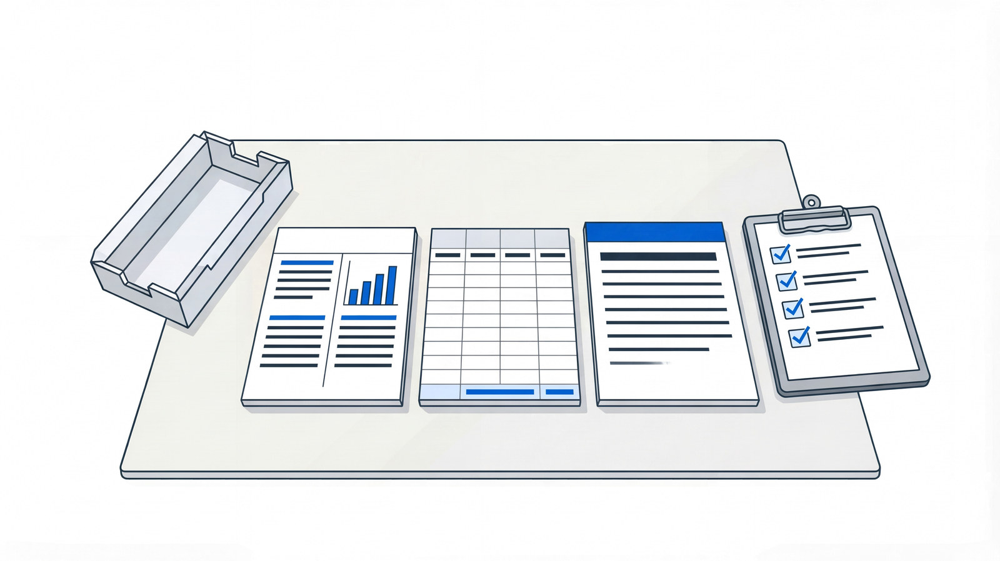
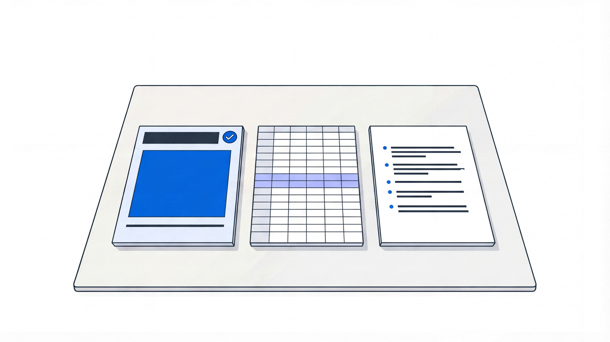
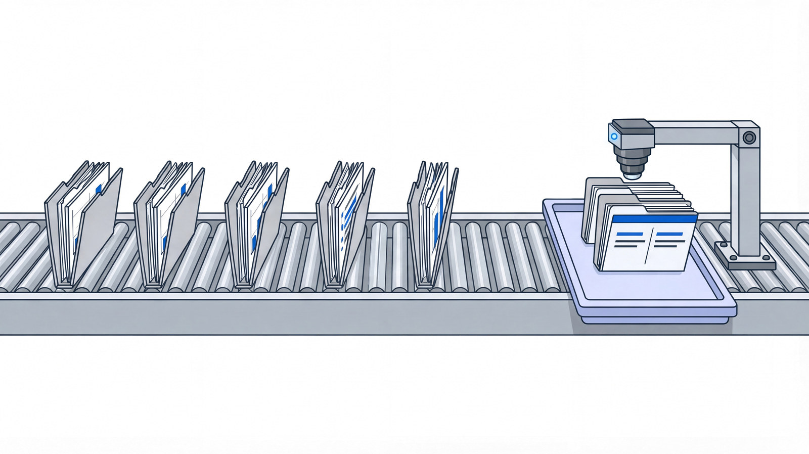

# 验证结果

模型回你一句「已完成」，通常只说明它把字敲完了、或者把文件生成出来了。至于数据对不对得上原表、打开后版面有没有错位、末尾有没有漏掉几行，这些都得你自己过一遍验货桌才算数。

## 模型为什么会交出看似顺畅的错结果

模型不会故意骗人，但它天生倾向于把话接顺、把空填满。把三份业务文档汇总成方案时，一旦材料里缺了某个比率或两处数字没对齐，模型很少停下来追问。

它会顺着上下文猜一个像样的数字填进去，再把整段写得行云流水。只看会话里的汇报摘要，往往看不出破绽。开工前先在 [交代任务](/ai/02-brief) 定好可核对的验收标准，验货时逐条打钩，比凭感觉审稿省事得多。

## 打开实物文件看一眼

只要产出物是幻灯片、电子表格、文档、PDF 或网页这类实物文件，就不能只听会话摘要，必须打开最终文件亲眼核对。

生成幻灯片时，大纲和源码里每页都可能显得工整，切进放映模式却发现标题压住了图表，或文字溢出页面。模型声称「表格公式已修好」，点开单元格才看到里面只是静态数字，或者合计范围漏掉了最后三行。

哪怕 Harness 已经配了浏览器和 Office 查看工具，模型交稿前也未必主动打开检查一遍。平时顺手改两段文字，扫一眼没错字就能发；只要是发出去给别人看的文件、或者带图表和公式的成果，自己点开看一眼这一步省不掉。

## 数字和出处要回原表重算

文字可以扫读，但数字、日期和引用条款不能靠「读起来像真的」来放行。算账、统计和引用时，模型最常犯两类错：

- 算术与口径错：表格有隐藏行或筛选时，汇总容易漏掉一截；同比和环比也经常混着算。
- 移花接木：正文写着覆盖 12 个区域，底下明细表却只有 9 个；或者把废止的旧制度当成现行规定引进去。

核对这类内容不用全文重读。关键合计数和百分比拉回原始表格复算一遍，重要数据和结论顺着出处翻回原文件看一眼。只要源头和结果对得上，中间的修饰文字通常不会出大问题。

## 长稿和批量活，专挑这几处抽查

几十页的长报告或十几份批量文件，逐字全查不现实，平均用力反而会放走真问题。抽查时盯着模型最容易偷懒的几个地方看就行：

- **中后段与最小的一份**：模型写长文容易虎头蛇尾，末尾常用「等其余若干项」带过；批量任务里人数最少的小场次，常把模板套话直接露出来。
- **反复修改的段落**：改到三四轮的稿子，或套过特殊规则的那一份，重点查刚重写的位置，防止模型改 A 处时把定稿的 B 处改回去。
- **边界、汇总与结尾**：表格合计行、首尾两行、带「无/暂无/例外」的条目，以及批量交付的汇总页和最后一份，最容易漏项。

批量任务里同一类错误只要在两份以上同时冒头，立刻停下来改模板或源头名单后整批重跑，不要一份份打补丁。

## 挑出毛病直接指死位置，定稿顺手留个底

验货发现问题，别只回一句「感觉不对，再检查一遍」。模型不知错在哪，往往会把原本写对的地方一起重写，越改越乱。

打回时最好把位置和证据指死。比如直接告诉它「第 6 页柱状图还是上月旧数，按表 2 的 12% 更新」，或者截图圈出「第 3 页底部文字压住表格，删掉两行」。

定稿后顺手记录版本号、核对过的项目与底稿存放目录。后续换人接手或开新会话继续修改时，接手的人才能一眼认出哪一份才是验过货的底稿。

## 自查

<Checklist id="ch03-verify-check" :items="[
  '验货时对照了开工前写下的验收标准，而不是凭感觉挑刺吗？',
  '实际打开生成的幻灯片、表格或文档看版面与公式了吗，还是只看了会话摘要？',
  '关键数字、百分比和引用条款，回到原始材料里复算核对了吗？',
  '长稿中后段、批量最小份、大改段落和汇总页这几处高风险位置抽查了吗？',
  '打回修改时，把具体页码、行号、文件名或截图指给模型了吗？',
  '同一错误出现在两份以上批量文件时，停下来改源头模板重跑了吗？'
]" />

## 延伸阅读

- [Harness engineering for coding agent users](https://martinfowler.com/articles/harness-engineering.html) 的「Feedforward and Feedback」一节，英文。它把写给 AI 的规则叫作前馈，把测试和检查叫作反馈，说明两者缺一会出什么问题。
- [METR：AI 对资深开发者效率的影响](https://metr.org/blog/2025-07-10-early-2025-ai-experienced-os-dev-study/)，英文。一项随机对照实验显示，资深开发者在熟悉仓库里使用 AI 完成任务的时间反而多了 19%，提醒人们必须把验证成本算进总耗时里。
