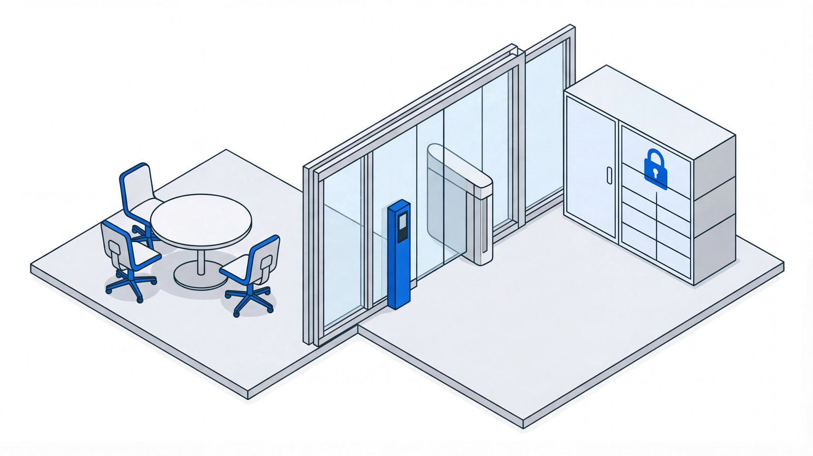
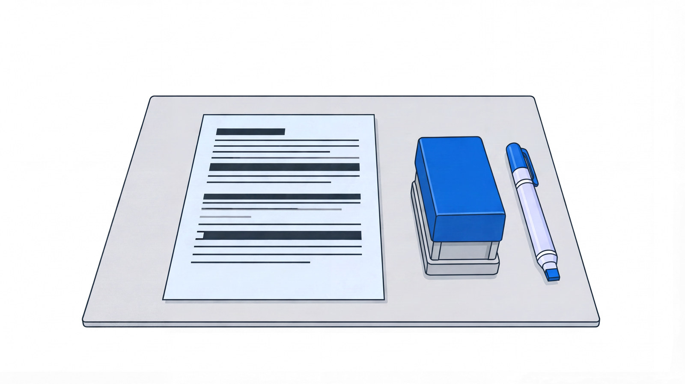
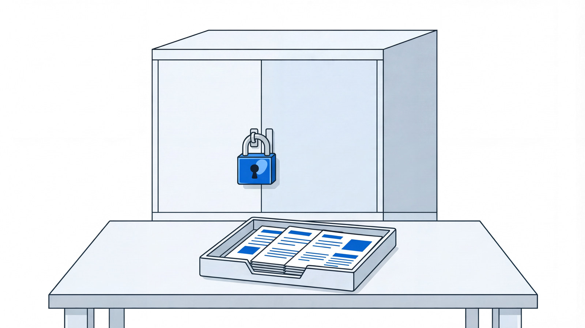

# 安全与边界

平时最容易出事的泄密，往往不是刻意干了什么，而是顺手点下的一次发送。内容一旦发出去，不只会留在你本机的记录里，后面每一轮追问还会顺着上下文反复传到远端。守住门禁其实就靠三件事：发之前给材料分分档，敏感项换成替身，给工具授权只开临时小目录并锁住外发。

## 危险跟着材料走，不跟着动作走

润色待发给客户的方案时，很多人习惯只盯着自己要让模型「干什么」：

<ChatMessage role="user" label="看似无害的一句润色请求" text="附件《XX 银行智慧网点项目方案-评审版.docx》帮我润色一下前三页的语气，改得客气专业一些，术语对齐客户习惯。" />

表面上看只是改前三页文字。可上一轮内部评审拼在文档末尾的两页附件——内部成本底价表和八名成员手机号——却跟着整份文件一起传了出去。

风险从不取决于动作有多轻，只取决于递出去的材料里装着什么。润色、翻译、改格式这类轻任务，往往最容易让人放松警惕。

<QuizCard
  question="客户发来一份未公开的《年度招标预算明细表》，现在只想让模型抽出一份纯结构提纲，不算具体金额。发之前怎么处理？"
  :options="[
    { text: '只列提纲不算金额，把原表发上去没关系', why: '风险跟着材料走，整张未公开预算表发出就已经脱离本地控制。' },
    { text: '在提示词开头加上“请对以下数据严格保密，不要外传”', why: '口头提醒挡不住内容进入本机记录与远端日志。' },
    { text: '先按受限材料处理：删掉金额与客户名称，只留表头和字段名再发', correct: true, why: '列提纲只需表头和字段结构，把真实金额与身份留在门内就能完成任务。' }
  ]"
/>

## 先分清材料轻重，敏感内容换成替身

发材料给外部模型前，先花十秒按三档划清边界：

| 档位 | 常见材料 | 处理方式 |
|---|---|---|
| 公开 | 官网简介、产品手册、公开报价单、已发布文章 | 直接放行 |
| 内部 | 内部方案、工作流程、非公开复盘 | 拆掉末尾附件与隐藏工作表，只带用得上的几页 |
| 受限 | 客户个人信息、员工薪资与身份证号、未定底价与折扣、密钥、未官宣计划 | 优先在本地合规环境处理；用外部工具前彻底脱敏 |

客户交来的招标文件、供应商报价和合作方名单，一律按受限材料处理。

脱敏忌讳把所有名词和数字全删成「XXX」，那样模型读不通主语和逻辑。稳妥做法是换成**结构相同、身份抹掉的替身**，同时留心别让几条线索拼起来反推出是谁。比如只改客户名称，却留下「华东区、制造业、两百人、采购周期 45 天」，圈内人拼起来照样猜得到是谁。

<PromptVersions
  title="同一段方案背景：直接贴原文 vs 替身脱敏后"
  :compare="true"
  :versions="[
    {
      label: '直接贴原文（高风险）',
      tone: 'warn',
      text: '本项目为华东某城商行（XX 银行总行，两百人科技团队，采购周期 45 天）定制网点系统，首年报价 86 万，底价可下浮至 7.5 折。项目经理张伟（138-0000-1234）负责对接，下周三前需提交终版。',
      note: '真名、手机号、精确底价和可反推身份的四个特征全留在一段话里。',
      effect: '润色时虽然只改语气，整段敏感底价和客户信息却已经发往外部。'
    },
    {
      label: '替身脱敏后（安全可润色）',
      tone: 'recommended',
      text: '本项目为某区域性金融机构（中型规模，标准采购流程）定制服务系统，报价为数十万元级别，按基准折扣适度下浮。项目负责人甲负责对接，近期需提交正式方案。',
      note: '保留了金融客户、定制系统、有折扣空间等全部写作结构，抹掉可反推真人的特征组合。',
      effect: '模型能顺利完成语气润色，同时不会因为看到“86 万”而擅自编造付款承诺。'
    }
  ]"
/>

脱敏结束后，站到外人视角通读一遍，确认光看文字无法反推出真人和真数再发。

## 贴进对话框前，先扫一眼这几样

实际工作里多数泄露源于图省事顺手贴出整段材料。贴进窗口前重点盯住下面这几样：

| 容易漏出的内容 | 常见翻车场景 | 稳妥做法 |
|---|---|---|
| 账号密码与令牌 | 贴报错信息或配置截图时整段复制 | 贴前删掉密钥所在行，只留变量名或占位符 |
| 客户姓名与联系方式 | 整理工单、回访记录时上传整张导出表 | 导出时删掉姓名、电话、地址列，只留编号和分类 |
| 未定稿报价与成本 | 方案末尾夹着内部测算表忘记拆分 | 先拆分文档，只传需要处理的那几页正文 |
| 员工信息与绩效 | 做排班或汇总时把人事总表整个丢进去 | 只抽取岗位和人数，不带入个人敏感字段 |
| 未公开业务计划 | 提前起草尚未宣布的调整通知或合作意向 | 等官宣后再用外部工具，或只讨论纯模板结构 |

还要避开两个常见错觉。删掉界面里的会话记录，不等于从远端日志撤回；复制报错和截全屏时，上下几行与浏览器标签页最容易夹带登录凭证。

## 授权工具时，只开临时目录并锁死外发

当 Harness 接入网盘、文档库、邮箱和群聊时，模型借用的是你本人的账号权限。如果不划边界，你让它「改一版发给评审人」，它很可能直接把邮件发出去。给工具开权限、跑自动批处理时，把下面这几条卡死：

1. 只开临时小目录。手头只改三页正文，就单建一个临时文件夹放这三页脱敏文件，别把整个部门共享盘都挂给它。
2. 外发和覆盖停在草稿。读资料和写草稿可以放手跑，但凡涉及发邮件、发群消息或覆盖正式文件，一定要在指令里写清先停在草稿，等你确认过再动手。
3. 定时或无人值守先设上限。自动批处理要写死时长和次数上限，超时就停，别让它在报错上一直死循环。
4. 出异常就立刻通知到人。批处理交回状态核对清单后，一旦发现份数不对或文件打不开，马上中断并通知具体负责人。

## 实际发给模型时，安全写法长这样

把「分档、替身、锁权限」串进同一套交付包，下面这套写法可以直接套用到日常外发润色场景：

<PromptVersions
  title="润色客户方案：直接丢原稿 vs 安全交付包"
  :versions="[
    {
      label: '危险做法：整份原稿直接贴',
      tone: 'warn',
      text: '附件《XX 银行智慧网点项目方案-评审版.docx》帮我润色一下前三页的语气，改得客气专业一些，做完发给评审人。',
      note: '末尾两页底价和名单一起出去了；授权边界没画清，还可能误发邮件。',
      effect: '敏感材料进了外部日志，或者草稿直接飞进了别人收件箱。'
    },
    {
      label: '安全交付包：先拆后脱敏 + 划清权限',
      tone: 'recommended',
      text: '帮我润色《临时待润色目录》里的《方案正文-脱敏版.docx》，里面的报价和人员附件我都拆掉了，客户名也换成了化名。\n\n只改前三页的语气，改得客气克制一点就行，别自己加原本没有的交付承诺或金额。改完另存成《方案正文-润色草稿.docx》，别覆盖原文件，也别调用邮件或群消息发出去，我拿回来自己填回真实名称和报价。',
      note: '目录先收窄，正文先替身脱敏，输出另存草稿，外发动作彻底锁死。',
      effect: '既拿到了干净的润色成稿，底价、名单和发送权也全部留在门内。'
    }
  ]"
/>

## 自查

<Checklist id="ch04-safety-check" :items="[
  '发送前给材料分过三档吗？末尾附件和隐藏工作表拆干净了吗？',
  '客户交来的招标文件、报价和名单，都按受限材料处理了吗？',
  '人名、金额以及能反推身份的特征组合，都换成结构一致的替身了吗？',
  '报错日志和全屏截图发出前，检查过里面有没有密钥或敏感标签页吗？',
  '只把本次必需的独立临时文件夹授权给工具，而不是整个部门共享盘吗？',
  '发邮件、覆盖正式文档和定时批处理，都设好草稿刹车与次数上限了吗？'
]" />

## 延伸阅读

- [The lethal trifecta for AI agents](https://simonwillison.net/2025/Jun/16/the-lethal-trifecta/) 的「Guardrails won’t protect you」一节，英文。讲清提示词与普通护栏为什么挡不住间接注入，必须靠隔离权限来防。
- [Claude Code 最佳实践](https://code.claude.com/docs/zh-CN/best-practices) 的「用权限规则和沙箱限制访问」一节，中文。讲如何用拒绝规则和目录沙箱守住操作边界。
- [《人工智能小白书》](https://lixiaolai.com/books/little-book-of-ai) 的第 2 章「安全永远第一」，中文。用直观例子讲清普通用户最该防的隐私与边界风险。

注：具体章节及页码，取决于发行版本。

