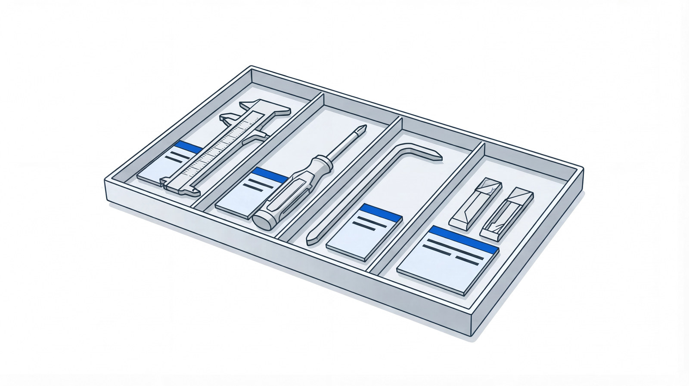
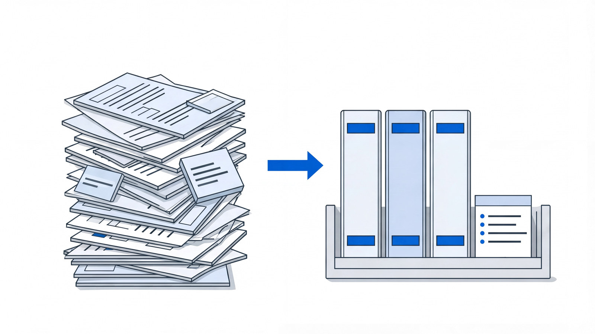

# 知识沉淀

同一套周报格式、统计口径和排版规矩，每次新开会话都重新贴一遍，不光麻烦，赶时间还很容易漏掉一两条。想把这些反复交代的习惯留下来，不用大动干戈搭什么体系，按平时用得到的地方分开放就行。

## 写在哪儿才合适：全局指令、项目指令和技能

把规矩放到各自合适的地方，免得每次开工把无关内容全塞进对话：

- **写进全局指令**：你个人跨所有项目都生效的短习惯，比如先给结论再给理由、不确认就先问、用中文回复。全局指令放在工具自己的个人配置里，只写几条铁规矩就行。
- **写进项目指令（`AGENTS.md`）**：当前工作区或仓库每次都要遵守的短规矩。常见包括面向谁写、严禁碰哪条红线、易混指标口径、唯一可信数据源路径。每次开工自动加载，因此篇幅保持简短，写法参考 [项目指令 AGENTS.md](/templates/agents-md)。
- **做成按需加载的技能（Skills）**：像「写部门周报」「整理客户回访」这类带步骤、模板和例子的专门活儿。平时不占当前会话上下文，触发时再读进来。

至于踩坑卡片、复盘和决策记录，平时不自动加载，需要时再翻阅，做法见 [笔记与清单](/foundations/06-notes-checklist) 和 [复盘与决策](/engineering/05-postmortem)。

<InkFigure src="/img/assets-layers.svg" alt="四种资产与加载时机：全局指令、项目指令、技能与记录" />

你也不用专门腾出一天来整理什么「技能库」。平时干活只要撞上下面这三种情况，顺手停下来，用工具自带的 `skill-creator`（有的工具里叫 `skills-creator`）打包一次就行：

<ChatMessage role="user" label="每周五都要重粘一遍的周报长指令" text="帮我写本周部门周报，给分管副总看，正文别超过两页。数据在销售表、项目表和客服工单表里。注意：完成率按项目条目数算，不要按工时算，延期但已交付的也算完成！活跃客户只算本月有回款的，别把试用账号算进去。先写结论再写进展、风险和计划，不准写客户全称。" />

1. 同一套话已经讲到第三遍。第一回直接干完，第二回顺手记一笔；等到第三次又要贴同一大段要求时，干脆花十分钟打包成技能。
2. 刚在会话里磨合出满意的成品。来回改了五六轮好不容易把口径和版面调顺，趁会话还没关，直接让它把刚才这套做法收成一个技能。
3. 漏掉一条就得整份重做的规矩。比如财务统计的例外情况、对外的脱敏红线，踩过一次坑，就该写进技能的交前自查里。

## 找 `skill-creator` 打包前，手头备齐这几样

你也不用自己去啃配置格式。只要你用的 Harness 支持技能功能，直接跟它说「帮我创建一个技能」，或者输入 `/skill-creator`，它就会反问边界、生成主文件、拆出参考材料，最后陪你试跑一遍。如果手头的工具暂时还不支持技能目录，先把核心口径和红线精简写进工作区根目录的 [项目指令 AGENTS.md](/templates/agents-md)，也一样能挡住大半重复说明。

找 `skill-creator` 之前，花五分钟把下面四样东西备齐，第一版技能就能跑得像模像样：

| 原材料 | 准备什么就够了 | `skill-creator` 会收进哪里 |
|---|---|---|
| 1 至 2 份满意成品 | 过去写得最顺手的两期真实成稿 | 反推段落顺序、颗粒度和语气，存成范例或模板 |
| 核心术语与口径 | 易算错的指标算法、唯一数据源表名和例外情况 | 写进口径说明或配套参考文件 |
| 禁区与自查项 | 禁用词、缺数标注方式、交稿前必须核对的点 | 写进技能红线和交货前自查步骤 |
| 触发与排除场景 | 什么时候启用（如写部门周报），什么时候别用 | 写成技能开头的触发描述，防止张冠李戴 |

原材料不用提前排成漂亮文档。把两份旧成稿、平时粘贴的指令和几条踩坑备忘直接交给 `skill-creator` 拆分就行。

## 从访谈定稿到试跑迭代

成熟的 `skill-creator` 在动手生成文件前，通常会先反问三四个边界问题。不要嫌麻烦跳过这一步，平时口头默认的习惯，往往就是靠这几问钉进规则里的：

<ChatThread title="用内置 skill-creator 沉淀《部门周报》技能">

<ChatMessage role="user" text="帮我用内置的 skill-creator 把部门周报做成个技能吧。每周要给分管副总看，控制在两页以内，数据从销售表、项目表和客服工单表里抓。记得两个口径：完成率按项目条数算，延期但已经交付的也算完成；活跃客户只算本月有回款的，试用账号不算。附件是我上周改到满意的那一版，按它的结构来。" />

<ChatMessage role="ai">

收到，我先对照范例整理了骨架。生成技能前需要确认 3 件事：

1. 三张数据表是固定路径，还是每周五由你手动提供文件？
2. 某条项目在工单表里缺记录时，标「未验证」还是直接跳过？
3. 初稿写完后，要不要按清单逐条输出核对位置方便复查？

</ChatMessage>

<ChatMessage role="user" text="文件名每周带日期，我自己拖进来就行；缺记录的地方直接标「未验证」，别猜着补；交之前记得自查一遍，以前老忘删客户全称或者忘改日期，写清楚每条核了哪张表。对了，写个人日报或者对客月报时别触发它。" />

<ChatMessage role="ai">

明白，已创建技能 `weekly-dept-report`，拆分如下：

- **触发说明**：仅在写部门内部周报时加载；个人日报与对客月报不触发。
- **核心指令**：先读三张表再成稿，缺数标“未验证”，交稿前逐条输出核对位置。
- **配套参考件**：《周报结构模板》与《核心口径表》已放进附属参考文件。

</ChatMessage>

</ChatThread>

文件生成出来，其实只算开了个头。新搭好的技能到底顺不顺手，还得另开一个干净的会话，拿上周的真表格实打实跑一轮，再对照以前人工定稿的结果核一遍。

<QuizCard
  question="刚用 skill-creator 生成周报技能后，拿上周真实表格试跑一遍，发现把 3 个内部测试账号也算进了“活跃客户”。接下来怎么做？"
  :options="[
    { text: '下次发周报时，在提示词末尾手动补一句排除测试账号', why: '手打补丁赶时间很容易漏掉，技能本身没有修正。' },
    { text: '回到 skill-creator，把这个错例喂给它，让它补进口径文件并重测一遍', correct: true, why: '把每一次踩坑修进技能里，以后在任何新会话调用都不会再犯。' },
    { text: '删掉技能，继续每次复制原来的 200 字长指令', why: '第一版漏掉边缘情况很正常，喂一个错例补齐一条规则就够了。' }
  ]"
/>

## 定期给技能箱瘦身与归档

技能攒多之后容易遇到这几个麻烦，每隔一两个月让 `skill-creator` 帮着理一遍就行：

1. 主文件越塞越胖。把十页案例和长表格全塞进主说明，一加载就会把上下文挤爆。主说明只留触发条件、步骤和红线就行，厚模板和口径表拆进附属文件，用到时再读。
2. 相似技能互相抢活。如果同时留着「周报助手」「汇报生成器」「月度总结」，触发说明又都写着「整理汇报」，模型就容易猜错。找位没参与搭建的同事，只让他看开头两句说明，分不清边界就趁早重写或合并。
3. 旧口径留着不归档。统计口径改版后，旧技能还留在常用目录里很容易带偏新人。改版时直接在原技能上更新并标明日期，已经废弃的旧技能顺手移出目录归档。

## 沉淀前后对比：从两百字说明到两句话唤醒

把规则和范例交给技能后，每次开工只需要提供本周的新材料与两句短指令：

<PromptVersions
  title="同一份部门周报：沉淀前 vs 用 skill-creator 沉淀后"
  :versions="[
    {
      label: '沉淀前：每周现敲 200 字',
      tone: 'warn',
      text: '帮我写本周部门周报，给分管副总看，正文别超过两页。数据在销售表、项目表和客服工单表里。注意：完成率按项目条目数算，不要按工时算，延期但已交付的也算完成！活跃客户只算本月有回款的，别把试用账号算进去。结构先写本周结论，再写进展、风险和下周计划，不要写空话，不要出现具体客户全称。',
      note: '每次开工现拼现粘，全靠记性不漏条。',
      effect: '赶时间漏掉一句“延期已交付也算完成”，整份周报口径算错被打回。'
    },
    {
      label: '过渡：唤起 skill-creator 打包一次',
      text: '把附件里这两份周报定稿、完成率和活跃客户的口径，还有交前自查的那几条，用内置的 skill-creator 打包成部门周报技能（就叫 weekly-dept-report）。只在写部门周报时触发，个人日报别触发。做好之后带我拿上周旧表试跑一轮看看。',
      note: '把反复交代的规矩和范例一次性交给 skill-creator，顺手回答两三句边界问题。',
      effect: '十来分钟搭好专属技能，模板、口径和自查清单自动拆成清晰结构。'
    },
    {
      label: '以后再用：每周五只发两句话',
      tone: 'recommended',
      text: '本周的三张表发在附件里了，用 weekly-dept-report 技能起草这周的部门周报。写完顺手把核对过的位置标出来，有缺数的列在下面让我看。',
      note: '步骤、口径和检查标准全留在技能里，每次开工只换本周的新表格。',
      effect: '两句话交代完，新人接手也能交出同样稳定的周报；以后口径有变，让 skill-creator 改一处就行。'
    }
  ]"
/>

## 自查

<Checklist id="ch05-assets-check" :items="[
  '个人通用习惯写进全局指令、工作区共同底线写进项目指令，带步骤和模板的活做成了按需加载的技能吗？',
  '同一套话讲到第三遍、或刚磨合出满意成品时，及时调用 skill-creator 打包了吗？',
  '找 skill-creator 之前，备好满意成品、口径表、禁区和触发排除场景这四样原材料了吗？',
  '技能生成完之后，在新会话里拿真实旧材料试跑并对照验证过吗？',
  '试跑发现漏算时，是回去让 skill-creator 更新技能，还是在当前会话打临时补丁？',
  '厚模板拆进附属文件了吗？互相抢活或过期的旧技能定期清理归档了吗？'
]" />

## 延伸阅读

- [Claude Code 最佳实践](https://code.claude.com/docs/zh-CN/best-practices)：读「保持 CLAUDE.md 简短」「将规则限定到代码库的某一部分」「将团队流程放进 skill」三节，中文。讲规则为什么要短、怎么拆范围与沉淀技能。
- [Anthropic 各团队怎样使用 Claude Code](https://claude.com/blog/how-anthropic-teams-use-claude-code)，英文。读「Documentation and knowledge management」与「Automation and workflow optimization」。两节分别讲文档管理与流程自动化。
- [12-Factor Agents](https://github.com/humanlayer/12-factor-agents)：读 Factor 3「Own your context window」，英文。讲清项目指令与按需技能如何帮人守住有限上下文。
