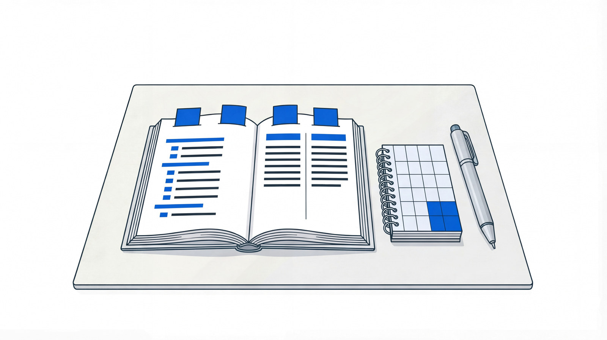

# 阅读

拿到一份四五十页的行业报告、一本厚厚的工具书，或者公司新发的操作手册，很多人习惯从第一页第一行往下硬啃，结果啃到第三页就走神放弃了。

卡住多半跟耐心没太大关系，问题出在拿同一种速度去读所有的材料。有的材料只值得五分钟摸清目录，有的必须逐字核清边界，还有的根本就不是给你从头通读的。先选对读法再翻开第一页，省下来的时间比读本身还要多。

## 换个读法，不用每份材料都逐字啃

《如何阅读一本书》把阅读拆成了四个层次。不用背名字，分清每一层用来解决什么问题就行。

| 层次 | 干什么用 | 什么时候用 |
|---|---|---|
| 基础阅读 | 认得字，看懂字面意思 | 日常读短消息、邮件 |
| 检视阅读 | 花几分钟抓清全貌和骨架，挑出该细读的几节 | 刚拿到长报告、新制度或一整本书 |
| 分析阅读 | 带着问题吃透整块内容，判断讲得对不对 | 读完检视阅读后，真正决定要学的核心章节 |
| 主题阅读 | 围绕同一个问题，同时翻几份资料交叉比对 | 写行业调研、做方案选型、定新流程 |

平时效率差，最常见的原因就是跳过了第二层。不管手里这份资料跟眼下要做的事有多大关系，一上来就拿分析阅读的力气逐字死磕，精力很快就被无关章节耗光了。

## 先做一遍「检视阅读」，画出目录地图

拿到长文档或者一本新书，先别急着从正文开啃。《如何阅读一本书》第 4 章给出的检视阅读就两步，加起来不用十分钟：

1. **有系统的略读**：看标题、看目录、看序言和摘要，再扫一眼高频出现的关键词。最后顺着目录挑两三个看着最核心的小节，翻进去读几段，摸清它的深浅和写法。
2. **粗浅地通读**：真准备快速过一遍时，碰到没见过的新名词或者复杂的公式图表，先拿记号标一下直接往后跳，把能看懂的那一半先连成一条线。在开头卡死细节，后面的全貌往往就看不到了。

这几分钟翻完，先停下来回答自己三个问题：它到底在讲什么、各部分是怎么铺开的、哪一两节才跟自己眼前这摊活直接有关。

<QuizCard
  question="部门刚发下来一份六十页的《年度业务合规与操作指引》，下周就要按里面的新规报批合同。先怎么读最省时间？"
  :options="[
    { text: '从第 1 页第 1 条开始逐字做笔记，读到合同那一章为止', why: '前面几十页可能全是不相关的历史沿革和通用条款，等你读到合同那一章精力已经耗光了。' },
    { text: '先花几分钟看目录、修订摘要和名词表，定位到合同审批那一章，再带问题精读那几页', correct: true, why: '先用检视阅读画出地图、跳过无关章节，再把细读时间全留给眼前要用的部分。' },
    { text: '直接把整份六十页文档丢给 AI 总结成三百字，以后都看总结', why: 'AI 摘要很容易漏掉例外条件和前提限制，涉及合规审批的条款必须自己回原文看清。' }
  ]"
/>

## 分清资料属于哪一类，别拿字典从头背

除了厚书，日常工作中更常打交道的是软件指南、制度说明和各种在线手册。文档分类框架 [Diátaxis](https://diataxis.fr/) 把这类材料分成四种，每一种读法完全不一样。

| 类型 | 写来干什么的 | 怎么读才对 |
|---|---|---|
| 教程 | 手把手带你做出第一个小成果 | 跟着一步步动手做完，光看屏幕记不住 |
| 操作指南 | 解决某一个具体的常见任务 | 遇到问题时再去查，按步骤对照着做 |
| 参考手册 | 完整罗列参数、字段、费用和条款 | 它是字典，绝对别通读，查到哪一条就看全那一条 |
| 原理解释 | 讲清楚背后为什么要这样设计 | 先上手用顺了，再回来读懂背后的道理 |

拿到手先看三样东西，版本对不对、最后更新是什么时候、例子里有没有省略的前提。版本一旦对不上，或者更新日期停在两年前，整页流程都可能已经改过了。

## 真要啃透时，带着问题做主动阅读

遇到确实值得细读的核心章节，最怕眼睛从左上角滑到右下角，合上文档脑子里却什么都没留下。《如何阅读一本书》给的办法是手里拿支笔，逼自己一路回答四个问题。这一段整体在谈什么、它是拿哪几步展开的、下的结论站不站得住、跟我手头的事有什么关系。

《程序员的思维修炼》第 6 章把主动阅读总结成更顺手的 **SQ3R 五步**。先浏览全貌（Survey），把目录改写成自己想问的问题（Question），再带着问题去精读（Read）。读完一节合上材料用自己的话复述一遍（Recite），隔两天再回头看一遍（Review）。

现在也经常遇到 AI 写出来的脚本、网页小工具或者复杂表格公式。读这类东西的时候，也不用从第一行硬啃到最后一行。先把它跑起来，挑一个你最常用的按钮，顺着「点下去经历了哪几步、最后改到了哪」跟完一条线就够了。只要是你自己要交付或转交的东西，关键几步能用自己的话讲得通就行。

## 让 AI 当你的阅读地图，别替你读完

遇到陌生的长材料或复杂文件，让 AI 帮你铺地图、定页码、查漏理解特别省劲，但最后看原文核对的动作还是得留给自己。

| 你想做什么 | 可以这样问 AI |
|---|---|
| 摸清长文档全貌 | 读一下这份资料的目录和各章开头，说说它主要分成哪几块、每块解决什么问题，标出对应节名。 |
| 定点找某条规则 | 这份六十页的制度里，和「外包人员权限申请」有关的是哪几节？只列出节名、页码和一句话大意，原文我自己翻。 |
| 顺清一条复杂逻辑 | 我刚让另一个工具写了一段自动汇总表格的脚本，用外行能听懂的话，按步骤讲清它先读了哪张表、怎么筛数、最后写到了哪里。 |
| 检验自己读懂没有 | 第 3 节说新客户折扣要走总监审批，我的理解是不管金额大小都要走。对照原文，指出我哪里理解漏了前提。 |

拿到 AI 给的节名和页码后，一定自己翻到那一页扫一眼。模型做摘要时最容易把「除非金额超过五万」「仅限正式员工」这类限制条件顺手抹掉，只留给你一句看着很干脆的结论。

## 练习

1. 找一份最近放进收藏夹一直没打开的长报告或手册，按检视阅读先花五分钟看目录和开头，写出你打算细读的哪两节、直接跳过哪几节。
2. 对照 Diátaxis 四分法，翻出你工作里最常用的三份资料，分清哪份属于操作指南、哪份只是参考字典。
3. 挑一段最近让 AI 写出来的表格长公式、网页小工具或复杂方案，用自己的话向同事讲一遍；讲到卡壳的地方，让 AI 解释到你能复述为止。

## 延伸阅读

- 《如何阅读一本书》：读第四章「检视阅读」和第六至十一章「分析阅读」的核心规则，中文。快速筛选材料、带着问题拆透一本书的底层方法全在这里。
- [Diátaxis](https://diataxis.fr/)：看首页的四种文档定位和对照关系，英文，五分钟读完。分清手里拿到的是教程还是参考词典，以后就不会再用错读法。
- 《程序员的思维修炼》：读第 6 章「主动学习」的 6.7 节，中文。里面把 SQ3R 主动阅读法拆成了能照着走的五步动作，不只是写代码能用，读任何专业资料都适用。

注：具体章节及页码，取决于发行版本。

