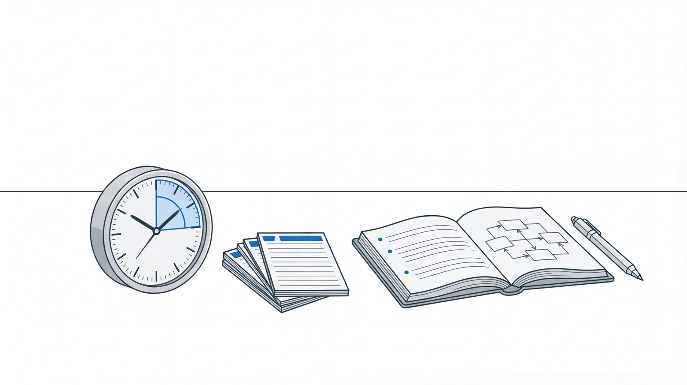

# 学习

教程也看完了，荧光笔也画了一大堆，合上屏幕让自己从零搭一个新看板或者新流程，脑子里还是空的。

学不会很少是因为记性差，多半是把「看着觉得挺顺」误当成了「已经学会了」。AI 出现之后查概念、看示例只要几秒钟，但也正因为答案来得太快，假懂的幻觉比过去更容易藏住。

## 顺着大脑的规律学，戳破「看懂了」的幻觉

《学习之道》和公开课 *Learning How to Learn* 把大脑学新东西的规律讲得非常清楚，日常能直接用上的就这四条：

1. **用「主动提取」对抗能力幻觉**：反复重读笔记、在材料上画满重点，是自学里最容易上当的假动作。课程里叫它**能力幻觉**，内容明明摆在眼前，大脑以为自己掌握了。真正有效的是**提取练习**，学完一小节就把屏幕遮住，逼自己先讲一遍或者做一遍，卡住后再翻回去核对。
2. **专注模式和发散模式换着用**：死盯一个卡死的问题一两小时，思维会锁在一条窄胡同里，这叫专注模式打死结。站起来去倒杯水、走两圈或者先去做件不需要动脑的小事，让大脑后台的发散模式把远处的经验连起来，回头往往一眼就看明白了。
3. **把动作打包成「组块」，分天间隔练**：新手学数据透视表时，要死记十几个按钮位置；熟练之后脑子里只剩一个完整的动作块「导入清洗→拖行列→核合计」。同样花两个小时，拆成四天每天练半小时，比周末一口气硬看两小时记得牢得多。
4. **治拖延盯过程，别盯庞大结果**：人不想动手，往往是因为一想到「我要学会整个新系统」就觉得头皮发麻。别管最终能不能做出来，只定一个 25 分钟计时器，承诺自己这 25 分钟里不看手机专心做第一步，到点就彻底停下来歇会儿。跨过开头五分钟的阻力，后面反而顺了。

## 自学半途卡住，多半撞上了这几道坎

就算知道上面四条规律，很多人学着学着还是会半途停掉。《自学是门手艺》点破了三个几乎每个人都会撞上的心理坎。

1. **过早引用**（第 12 章）。看新工具或新领域的材料时，前面几章常常会冒出后面才解释的术语。这时候别一头扎进去非把前置名词查个底朝天，越查越散，还没进正门人先累垮了。先拿问号标一下跳过去，等后面真用到了再回来补，很多概念顺着上下文自然就通了。
2. **受不了前几天的笨拙**（第 14 章）。不管以前在熟悉的岗位上多熟练，换到新工具面前，前两三天就是会点错按钮、动作别扭。很多人不是学不会，是受不了自己看起来像个新手。给自己留几天笨拙期，手熟了速度自然就起来了。
3. **刚需幻觉**（第 33 章）。人很容易因为现在还不会某个技能，就下意识觉得「反正日常工作里用不上」。试着先倒推一个具体的成品出来，比如别写「学会数据分析」，而是定成「两周内做出一张每周自动刷新的区域销售看板」。前面挂着要交的成果，学哪些、先跳过哪些一眼就能看清。

## 用费曼技巧验真假，让 AI 当你的教练

到底有没有真学懂，[费曼技巧](https://fs.blog/feynman-technique/) 的逻辑最直接：**如果你没法用大白话把一个概念讲给外行听懂，说明你自己也没真懂**。

套在工作里就四步。挑出要学的主题，把自己已经知道的写在一张白纸上。接着假装对面坐着一个完全不懂这一行的新同事，不用任何缩写和行话把来龙去脉讲一遍。讲到卡壳、含糊或者只能照念术语的地方，立刻翻回原资料查透，最后换成日常类比再顺一遍。

过去这一步很难有人陪你练，现在刚好把 AI 拉来当教练。不过开场就要把规矩立住，让它出题、追问、挑错，动手和思考的部分一定留给自己。

<ChatMessage role="user" label="示例" text="我想学着用表格的数据透视表和基础函数做月度销售对比看板，目的是我自己彻底学会，不是直接拿现成文件交差。请你当教练：先给我一个分四步走的练习顺序，每步只说要做什么、用到哪两个概念，先别直接替我写好公式；我每做完一步把结果和卡点贴给你，你指出问题后再往下一步走。" />

平时学别的新东西，下面这几种开口方式也可以直接拿去用：

| 卡在哪一步 | 怎么对 AI 说 |
|---|---|
| 先摸清学习路线 | 我要在两周内做出某某看板。现在完全没用过这个工具，帮我排一个从易到难的学习顺序，每一步说明练完能做出什么小东西。 |
| 搞懂陌生概念 | 用一个日常做饭或收拾桌面的例子类比这个概念，再告诉我这个类比到哪一步就不成立了，免得我理解偏。 |
| 用费曼技巧自查 | 我按自己的理解把这套报销审批流复述给你听，你别客气，专门挑出我讲错、跳步或者用套话糊弄过去的地方。 |
| 错题拆解 | 我照着操作结果算出来是错的，先别直接给我改好的结果，告诉我哪一步的理解大概率出了岔子，我该先查哪里。 |

## 分清什么时候自己啃，什么时候直接让 AI 干

当然不用把每件杂活都当成学习任务来硬啃。动手前先问自己一句，这件事是不是你本职工作里要反复干的核心本领？

如果是以后每个月都要自己改、出了错需要你来扛的核心本领，哪怕多花一点时间，也值得用教练模式慢慢摸透。如果只是偶尔碰上一次、又不属于你核心分工的小杂活，直接把要求和材料交代清楚交给工具跑完，自己核对一遍结果就行（第二章会专门讲怎么派活、怎么验货）。

<QuizCard
  question="部门下个月要上线一套新的数据看板工具，以后每个月都要由你负责更新字段和排查数对不对。怎么用 AI 开局最合适？"
  :options="[
    { text: '让 AI 直接把第一版看板模板搭好交差，自己以后每次改数都喊它帮忙', why: '一旦口径变了或者看板数字对不上，你完全看不出它改在了哪里，每次都得从零返工。' },
    { text: '让 AI 把官方帮助文档总结成一份三页纸速查表，先打印出来背完再动手', why: '看懂和背熟说明书很容易陷入能力幻觉，没自己亲手做过一遍，遇到真实卡点照样不会。' },
    { text: '拿一份上月真数据定个最小成品目标，让 AI 分步引导操作、只给提示不直接代做，做完后自己复述一遍逻辑', correct: true, why: '从真目标倒推、自己动手配合主动提取复述，才能真正把这套能力变成自己的。' }
  ]"
/>

## 练习

1. 挑一个你最近在用的工具或流程里始终有点模糊的概念，用费曼技巧讲给 AI 听，让它专挑你讲不清的地方发问。
2. 选一个两周内想掌握的新工作流，写成一个具体的「能做出来的东西」，用上面的示例消息让 AI 当教练带你跑通第一步。
3. 今天试一次学完一小节新材料后合上页面，先用空白纸写出刚才记住的要点和步骤，再打开原文对照缺了什么。

## 延伸阅读

- [《自学是门手艺》](https://lixiaolai.com/books/the-craft-of-selfteaching)：读第 12 章「如何从容应对含有过多“过早引用”的知识？」、第 14 章「笨拙与耐心」和第 33 章「刚需幻觉」，中文。书里拿 Python 举例，但这三章讲的自学卡点对学任何新工具都成立。
- [如何学习：学习困难科目的实用思维方法](https://www.coursera.org/learn/learning-how-to-learn)：看第 1、2 模块，视频共约 3 小时 20 分，有中文字幕。专注与发散模式、组块化和对抗能力幻觉的实验依据都在这两模块里（对应中文书《学习之道》）。
- [10 分钟速成课：学习技能](https://www.bilibili.com/video/av16785517)：先看第 3 集「记忆」和第 6 集「拖延症」，两集共约 21 分钟，中英双语字幕。想快速掌握提取练习怎么练、怎么跨过拖延开第一步，看这两集最省时间。

注：具体章节及页码，取决于发行版本。

